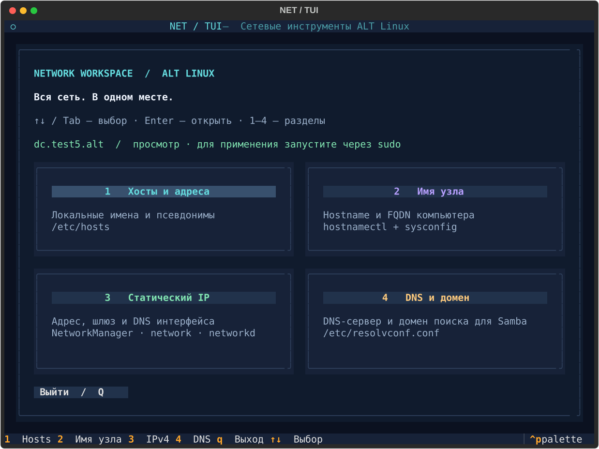

# NET / TUI

Цветная терминальная панель сетевых настроек для ALT Linux.



- **Хосты:** добавление записей и редактирование `/etc/hosts`, проверка IPv4/IPv6 и имён.
- **Имя узла:** `hostnamectl set-hostname`, `/etc/hostname` и `HOSTNAME` в `/etc/sysconfig/network`.
- **Статический IPv4:** интерфейс, адрес с префиксом, шлюз, DNS и домены поиска. Автоматический выбор активного NetworkManager, ALT `network` (etcnet) или systemd-networkd. Для NetworkManager нужен активный управляемый профиль; для networkd проверяется наличие более ранних профилей.
- **DNS для Samba:** `name_servers` и `search_domains` в `/etc/resolvconf.conf`, затем `resolvconf -u`. Samba и домен AD этим не устанавливаются.

## Запуск

```sh
python3 -m pip install .
net-tui tui          # просмотр без root
sudo net-tui tui     # применение настроек
```

Для сервера без графической среды или подключения по SSH:

```sh
sudo net-tui --color tui --no-mouse
```

Графическая среда не требуется ни в одном режиме. `--no-mouse` отключает обработку мыши в терминале.

| Клавиши | Действие |
| --- | --- |
| `1`–`4` | Открыть раздел с главного экрана |
| `↑` / `↓`, `Tab`, `Shift+Tab` | Выбор пункта меню |
| `Enter` | Открыть пункт или нажать выбранную кнопку |
| `Tab` / `Shift+Tab` | Следующее / предыдущее поле формы (включая редактор hosts) |
| `↑` / `↓`, `Enter` | Выбрать интерфейс в раскрытом списке |
| `F3` | Добавить введённую запись в hosts |
| `F2` | Предпросмотр; в окне предпросмотра — применить изменения |
| `F10` | Назад; в главном меню — выход |
| `Esc` | Закрыть список, отменить предпросмотр или вернуться назад |
| `Q` | Выход с главного экрана |

Все системные изменения требуют подтверждения в окне с diff и командами.

Например: имя узла `dc.test5.alt`, статический адрес `192.168.1.10/24`, DNS `192.168.1.10`, домен поиска `test5.alt`.

## Применение

Файлы записываются атомарно; резервные копии сохраняются в `/var/backups/net-tui/`. При ошибке приложение пытается восстановить файлы и настройки, затем перезапустить соответствующую службу. Ошибки восстановления показываются в окне применения.

Перезапускается служба, управляющая выбранным интерфейсом: `NetworkManager`, `network` или `systemd-networkd`. Перезапуск может оборвать SSH. Автоматического отката по таймеру и проверки доступности внешней сети нет; сетевые изменения лучше выполнять с локальной консоли. Если питание или процесс прерваны, используйте резервные копии для ручного восстановления.

Требуются команды соответствующего backend (`nmcli` или etcnet или networkd), `hostnamectl`, а для DNS — установленный `resolvconf`.

## Проверка

```sh
python3 -m pytest -q
```

Тесты новых сценариев используют временные файлы и подменяют системные команды, не меняя настройки рабочей машины.

Форматы настроек сверены с документацией ALT: [etcnet](https://docs.altlinux.org/ru-RU/alt-server/11.0/html/alt-server/etcnet.html), [resolvconf для DC](https://docs.altlinux.org/ru-RU/alt-domain/11.1/html/alt-domain/nastrojka_resolvconf.html).
